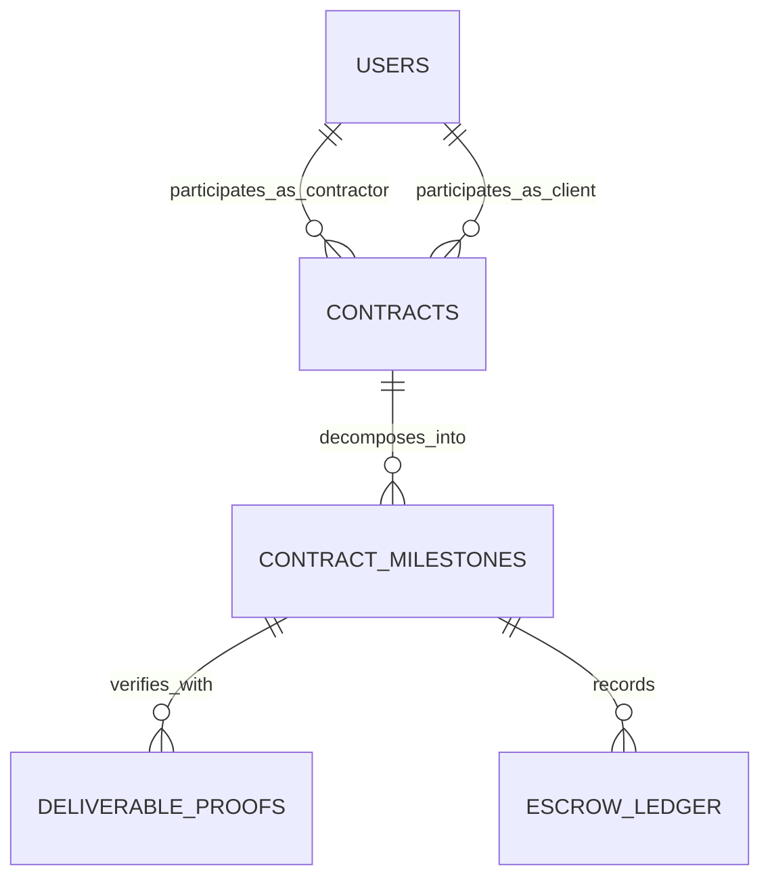

# MilestonePay AI - Database Schema & Data Architecture Specification

> **Autonomous Scope-of-Work Generator & Deliverable-Verified Milestone Escrow Protocol**  
> Architecture & Data Modeling Specification  
> Author: `@SchemaAgent`

---

## 1. Executive Architecture Overview

**MilestonePay AI** solves freelancer non-payment and client scope creep by locking funds in Stripe escrow vaults and releasing them upon cryptographic verification from automated oracles (GitHub PR merge, Vercel staging deploy, Figma review), backed by an unconditional 72-hour dispute window auto-release guarantee.

---

## 2. Entity-Relationship Diagram (ERD)



---

## 3. PostgreSQL SQL Definition

```sql
CREATE TYPE user_role AS ENUM ('FREELANCER', 'AGENCY', 'CLIENT');
CREATE TYPE contract_status AS ENUM ('DRAFT', 'AWAITING_DEPOSIT', 'IN_PROGRESS', 'COMPLETED', 'DISPUTED');
CREATE TYPE milestone_status AS ENUM ('PENDING_FUNDING', 'FUNDED_IN_ESCROW', 'DELIVERABLE_SUBMITTED', 'IN_REVIEW', 'RELEASED', 'DISPUTED');
CREATE TYPE verification_type AS ENUM ('GITHUB_PR', 'VERCEL_DEPLOY', 'FIGMA_APPROVAL', 'MANUAL_SIGN_OFF');
CREATE TYPE ledger_tx_type AS ENUM ('ESCROW_DEPOSIT', 'ORACLE_RELEASE', 'DISPUTE_REFUND');

CREATE TABLE users (
    id UUID PRIMARY KEY DEFAULT gen_random_uuid(),
    email VARCHAR(255) UNIQUE NOT NULL,
    full_name VARCHAR(100) NOT NULL,
    role user_role DEFAULT 'FREELANCER',
    stripe_account_id VARCHAR(100),
    created_at TIMESTAMPTZ DEFAULT NOW()
);

CREATE TABLE contracts (
    id UUID PRIMARY KEY DEFAULT gen_random_uuid(),
    freelancer_id UUID NOT NULL REFERENCES users(id),
    client_id UUID NOT NULL REFERENCES users(id),
    title VARCHAR(200) NOT NULL,
    total_value_usd NUMERIC(10, 2) NOT NULL,
    contract_status contract_status DEFAULT 'DRAFT',
    raw_scope_summary TEXT NOT NULL,
    legal_agreement_text TEXT NOT NULL,
    freelancer_signed_at TIMESTAMPTZ,
    client_signed_at TIMESTAMPTZ,
    created_at TIMESTAMPTZ DEFAULT NOW(),
    updated_at TIMESTAMPTZ DEFAULT NOW()
);

CREATE TABLE contract_milestones (
    id UUID PRIMARY KEY DEFAULT gen_random_uuid(),
    contract_id UUID NOT NULL REFERENCES contracts(id) ON DELETE CASCADE,
    title VARCHAR(150) NOT NULL,
    description TEXT NOT NULL,
    amount_usd NUMERIC(10, 2) NOT NULL,
    status milestone_status DEFAULT 'PENDING_FUNDING',
    verification_type verification_type DEFAULT 'GITHUB_PR',
    verification_criteria JSONB NOT NULL,
    escrow_charge_id VARCHAR(100),
    review_window_expires_at TIMESTAMPTZ,
    released_at TIMESTAMPTZ,
    created_at TIMESTAMPTZ DEFAULT NOW()
);
CREATE INDEX idx_milestones_contract ON contract_milestones(contract_id);

CREATE TABLE deliverable_proofs (
    id UUID PRIMARY KEY DEFAULT gen_random_uuid(),
    milestone_id UUID NOT NULL REFERENCES contract_milestones(id) ON DELETE CASCADE,
    proof_type verification_type NOT NULL,
    proof_url VARCHAR(512) NOT NULL,
    proof_metadata JSONB NOT NULL,
    verified_by_oracle BOOLEAN DEFAULT FALSE,
    verified_at TIMESTAMPTZ,
    auto_release_triggered BOOLEAN DEFAULT FALSE,
    created_at TIMESTAMPTZ DEFAULT NOW()
);

CREATE TABLE escrow_ledger (
    id UUID PRIMARY KEY DEFAULT gen_random_uuid(),
    contract_id UUID NOT NULL REFERENCES contracts(id) ON DELETE CASCADE,
    milestone_id UUID NOT NULL REFERENCES contract_milestones(id) ON DELETE CASCADE,
    amount NUMERIC(10, 2) NOT NULL,
    transaction_type ledger_tx_type NOT NULL,
    stripe_transfer_id VARCHAR(100) NOT NULL,
    created_at TIMESTAMPTZ DEFAULT NOW()
);
```
